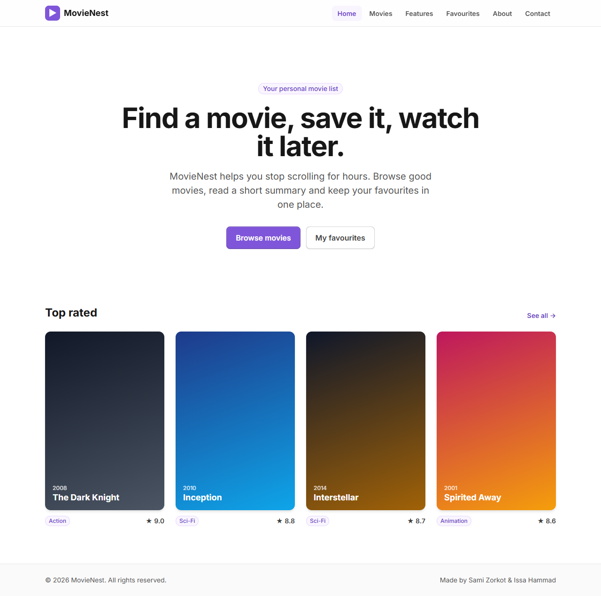
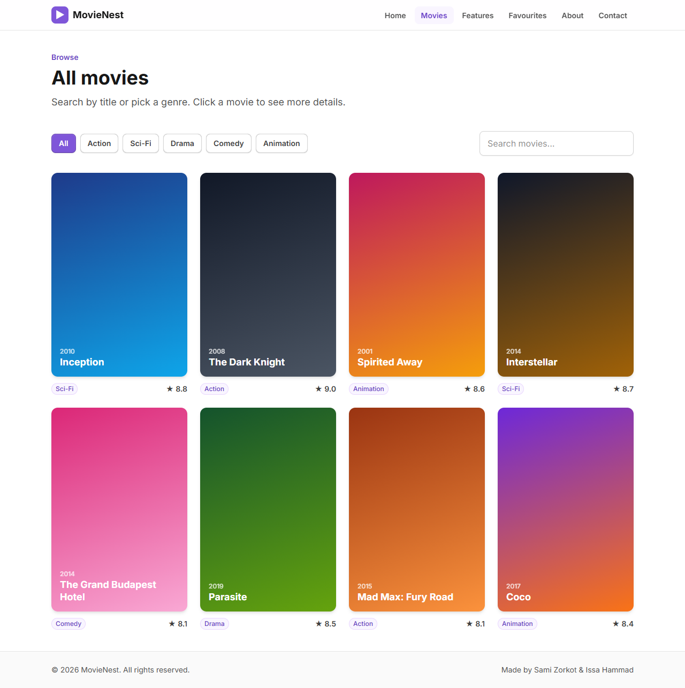
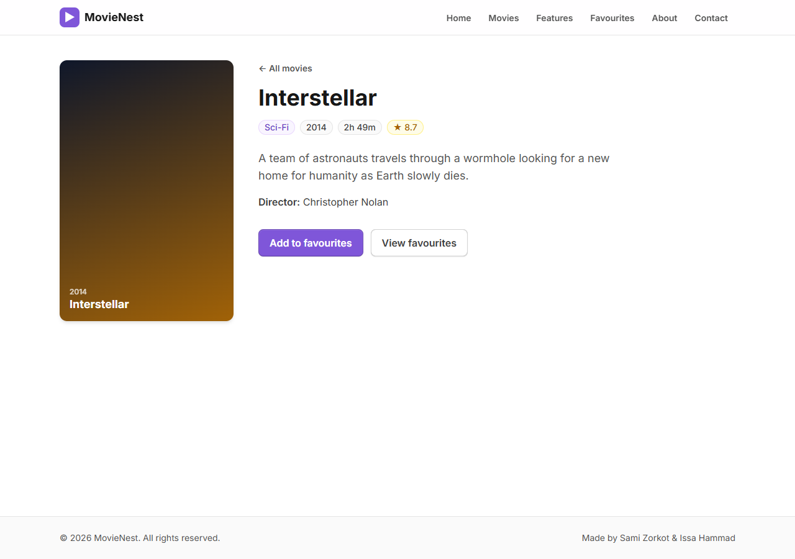
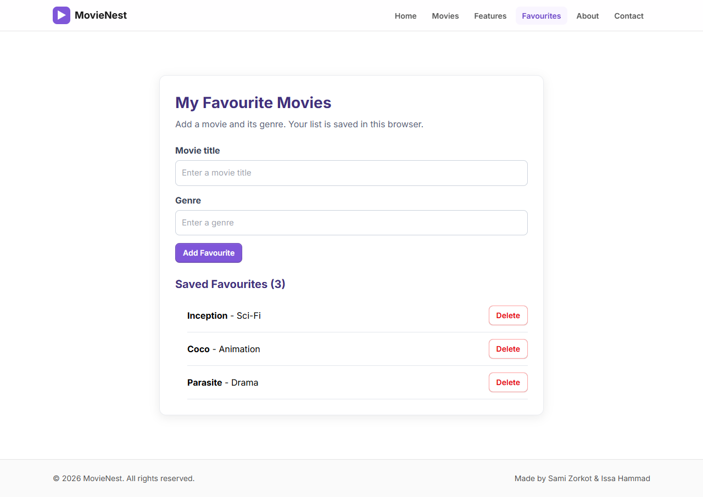
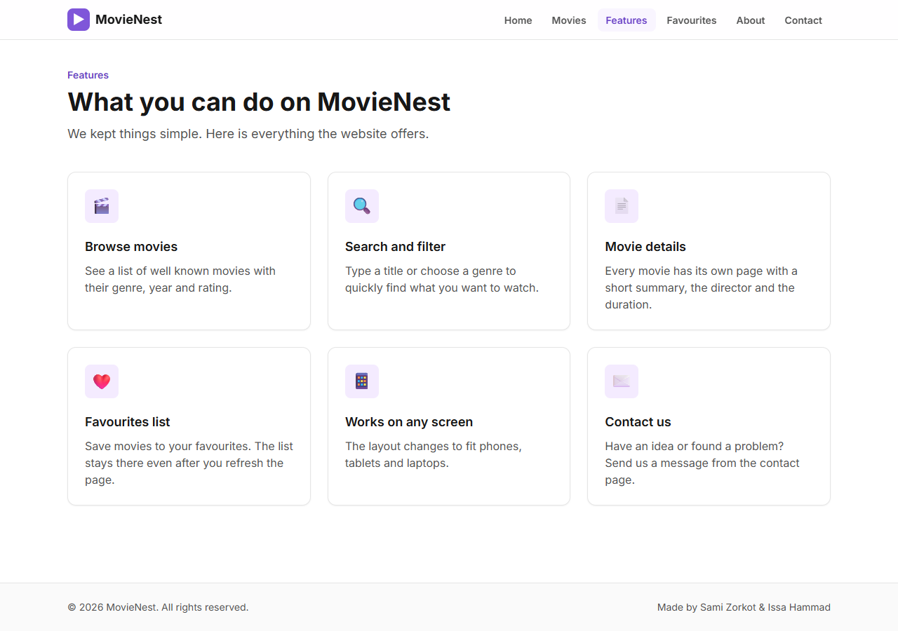
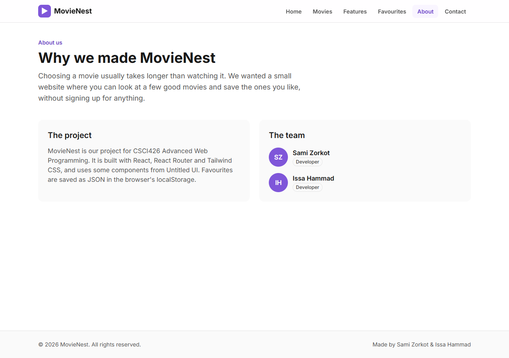
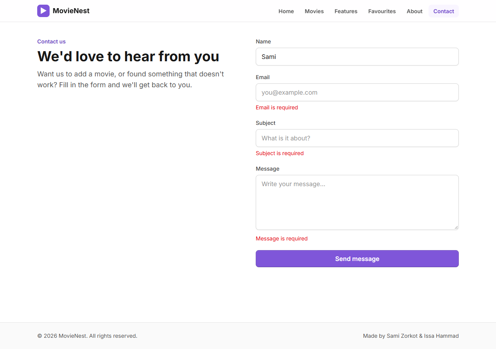
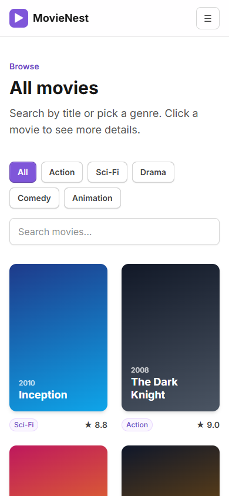
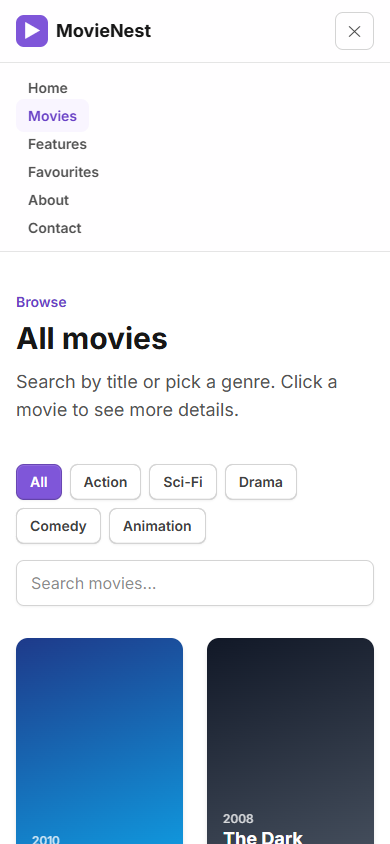

# MovieNest

MovieNest is a small movie website made for the CSCI426 Advanced Web Programming project (Phase 1).
It helps people who spend too much time choosing what to watch: you can browse a short list of good movies,
search and filter them by genre, open a page for each movie, and save the ones you like to a favourites list
that stays saved in the browser (localStorage).

Made by **Sami Zorkot** and **Issa Hammad**.

Live website: https://sami-csci.github.io/movienest/

## Pages

| Page | Path | What it does |
| --- | --- | --- |
| Home | `/` | Intro and the top rated movies |
| Movies | `/movies` | All movies with search and genre filter |
| Movie details (dynamic) | `/movies/:id` | Details of one movie, add it to favourites |
| Features | `/features` | What the website offers |
| Favourites | `/favourites` | Add, list and delete favourites (saved as JSON in localStorage) |
| About | `/about` | About the project and the team |
| Contact | `/contact` | Contact form with validation |

## Technologies

- React 19 with Vite
- React Router (HashRouter so it works on GitHub Pages)
- Tailwind CSS 4
- Untitled UI React components (Button and Badge) – https://www.untitledui.com/react/components
- localStorage and JSON for the favourites
- gh-pages for deployment

## Setup

You need Node.js installed.

```bash
git clone https://github.com/Sami-CSCI/movienest.git
cd movienest
npm install
npm run dev
```

Then open the link shown in the terminal (usually http://localhost:5173).

To build and publish to GitHub Pages:

```bash
npm run deploy
```

## Screenshots

### Home


### Movies


### Movie details


### Favourites


### Features


### About


### Contact


### Mobile
 

## Credits

- The components inside `src/components/base` and the files in `src/styles` and `src/utils` come from
  [Untitled UI React](https://www.untitledui.com/react) (MIT license), added with the `untitledui` CLI.
- The favourites page is based on the "React Favourites Application" from the course tutorial
  *JSON, React and Local Storage*.
